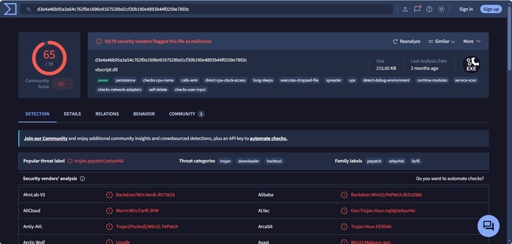
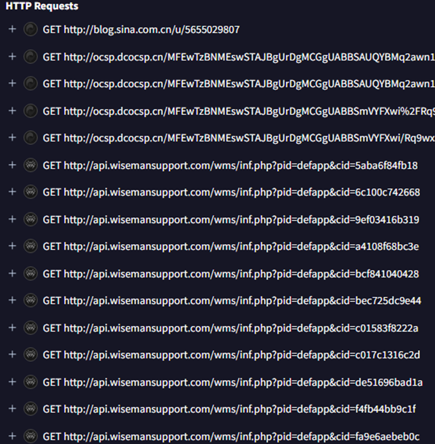
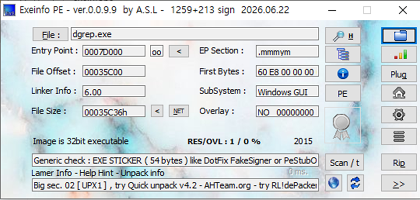
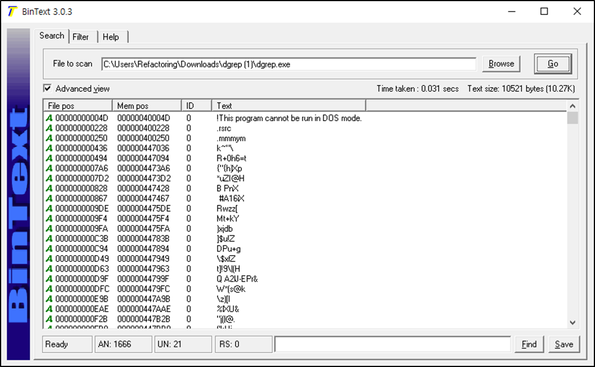
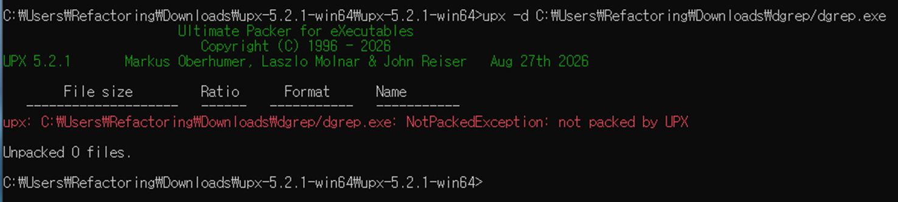
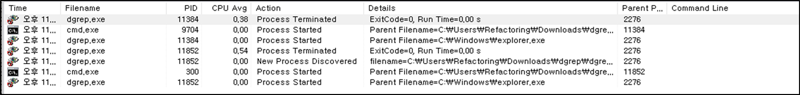
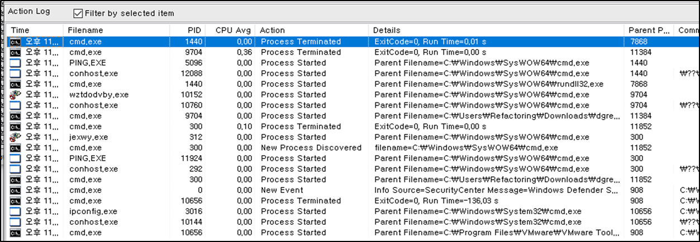

# Malware Analysis: `dgrep.exe`

## Basic Analysis

### VirusTotal Analysis

More than 60 vendors flagged the sample as suspicious for Trojan behavior.

The sample appeared to attempt communication with the following domains:
- `blog.sina.com.cn`
- `ocsp.dcocsp.cn`
- `api.wisemansupport.com`

---

## Static Analysis

### Exeinfo PE

The sample was unpacked by UPX-based packing method.

### BinText

No readable strings were found because the file was packed.

### Unpacking Process

An attempt was made to unpack the sample using UPX, but the unpacking failed.

Other unpacking tools were also investigated, but the relevant websites were inaccessible or suitable tools could not be found

---

## Dynamic Analysis

### Analysis Environment

The following dynamic analysis tools were prepared:

- CurrPorts
- Wireshark
- Process Monitor
- Process Explorer
- Autoruns

The analysis was performed five times using VMware snapshots.

Since the sample could not be successfully unpacked during static analysis, the dynamic analysis was conducted based on the information identified during the basic analysis.

For Process Monitor, the following executable files were used as filters:

- `dgrep.exe`
- `wiseman.exe`
- `jckcpgh.exe`
- `oucqi.exe`
- `kohhjfpe.exe`
- `ghxhx.exe`

In Wireshark, traffic was filtered based on the domains identified during the VirusTotal analysis:

- `dns.qry.name contains "blog.sina.com.cn" || dns.qry.name contains "ocsp.dcocsp.cn" || dns.qry.name contains "api.wisemansupport.com"`

### Malware Execution Results

#### 1. Executable File Deletion

The executable file was deleted immediately after execution.

#### 2. Process Monitor Results

`dgrep.exe`

- Started at 21:01:12
- Terminated at 21:01:53
- No additional activity was observed after termination.

No activity was detected for any of the filtered processes other than `dgrep.exe`.

#### 3. Wireshark Results

No communication with the domains identified during the VirusTotal analysis was observed.

It appeared that the sample did not attempt to establish communication with the identified domains.

#### 4. System Explorer

The sample was observed creating child processes during execution, including `ping.exe`, `jexwy.exe`, and `rundll32.exe`.

The sample was also observed creating a `ping.exe` process that sent a ping request to `127.0.0.1`, indicating a self-referential ping to the local host.

#### 5. CurrPorts and Autoruns Results

- No changes in startup processes were observed before or after execution.
- No additional network connections were observed before or after execution.

---

## Final Analysis

The sample appeared to attempt to download and execute additional executable files from an external source.

It appeared that the sample checked the Internet connection before attempting to communicate with external servers, but the external connection could not be established in the analysis environment.

As a result, the sample was determined to have been unable to perform its intended malicious behavior during the analysis.

