# Project Overview

## Objective: 
- Analyze a malware sample
- Design and validate detection patterns 
- Iterate on the rules to improve true positive detection rates.

## Duration: 2026-10-12 ~ 2026-11-14

## Execution Environment:
Separated into two isolated virtual machines: 
- Malware Execution VM 
- Detection VM.

| Category | Detailed Configuration (Common to Execution & Detection) |
| :--- | :--- |
| Virtualization Tool | VMware |
| OS | Windows 10 |
| Memory | 2GB | 
| Processors | 2 |
| Hard Disk | 60GB |

## Analysis Tools:
| Tool Name | Purpose |
| :--- | :--- |
| VMware | Building isolated virtual environments (execution & detection) |
| MalwareBazaar | Collecting malware samples |
| VirusTotal | Gathering initial threat intelligence and baseline analysis |
| Exeinfo PE | Checking for packing and obfuscation |
| De4dot | Deobfuscating .NET assemblies |
| Bintext | Extracting internal strings |
| PE View | Inspecting PE file headers and internal structure |
| ProcessMonitor | Monitoring real-time process and registry activities |
| SystemExplorer | Tracking process execution history and child processes |
| WireShark | Capturing and analyzing network packets |
| Snort | Signature-based intrusion detection |
| Base | Web portal for visualizing Snort alert logs |

## Procedure:

--- 


### 1. Malware Sample Selection
- Source & Criteria: Prioritized samples generating HTTP traffic on MalwareBazaar to facilitate network-based detection rule design.
- Target Info: AgentTesla family information-stealing malware.
- Hash Value: SHA-256 `78625ed6397b0cbfccde8e5701022ec6692880168b8dfb7a0fe388d3f13158f1`

--- 

### 2. Basic Analysis
- Detection Status: Flagged as a Trojan (AgentTesla) by 53 out of 71 security vendors on VirusTotal.

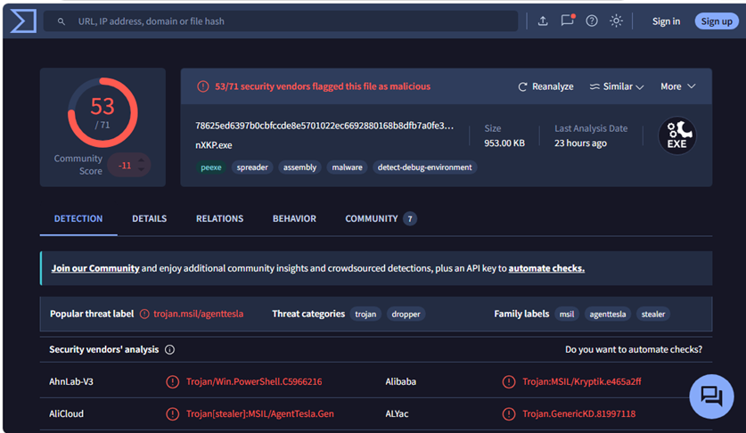

- Key Suspicious Behaviors: Observed adding a Windows Defender exclusion path via PowerShell and spawning `MSBuild.exe` as a child process.

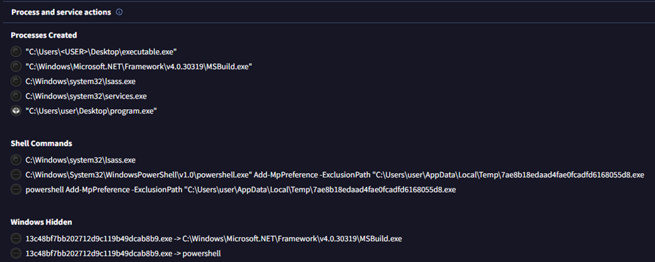

- Network Indicators: Identified HTTP GET requests to the external IP lookup service `ip-api.com` (`208.95.112.1:80`) to check hosting environment attributes.

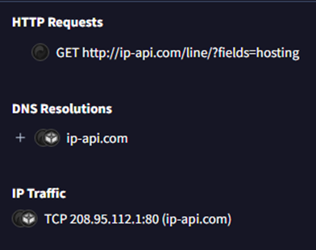


--- 

### 3. Static Analysis
- Packing & Obfuscation: Exeinfo PE analysis revealed that the binary was obfuscated using tools such as DeepSea and Babel.

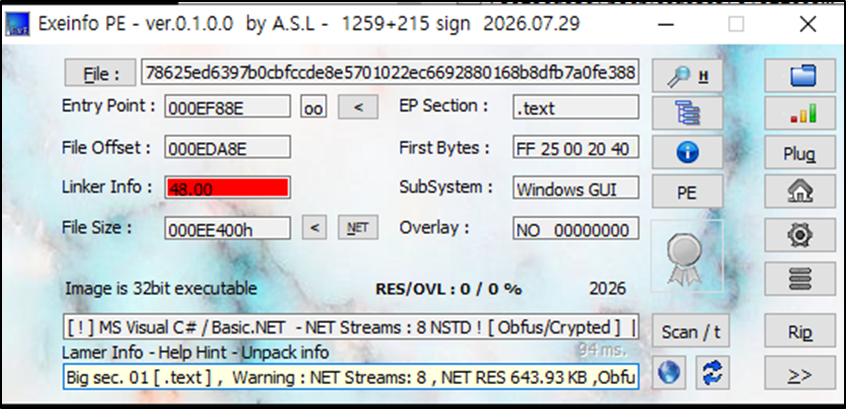

- Performed deobfuscation using `de4dot`.

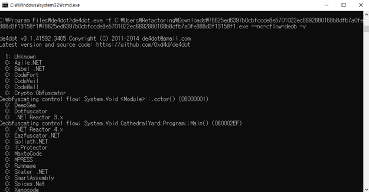

- String Extraction Limitations: Extracted strings using Bintext, but residual obfuscation prevented the recovery of direct IOC strings such as `ip-api.com`.

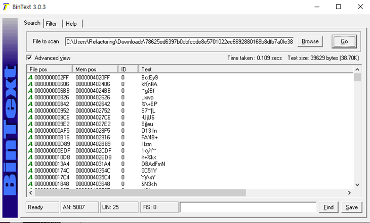
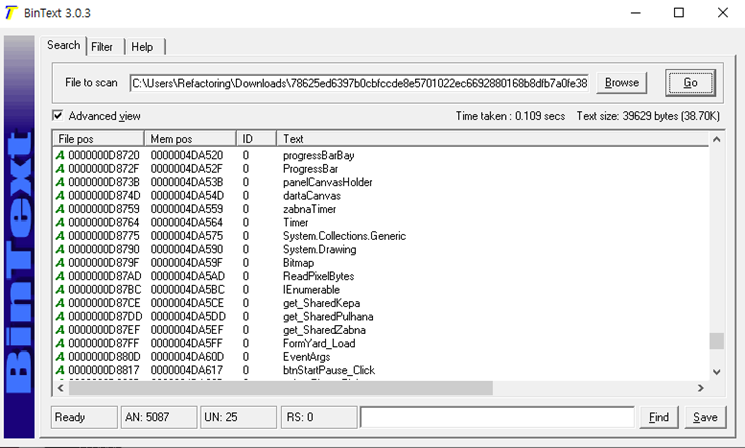

--- 

### 4. Dynamic Analysis
- Process Activity: Executed the sample more than 5 times using VMware snapshot restoration.
- Monitored via ProcessMonitor and SystemExplorer, confirming the background creation of the child process (`MSBuild.exe`).

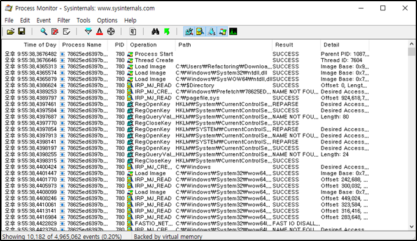
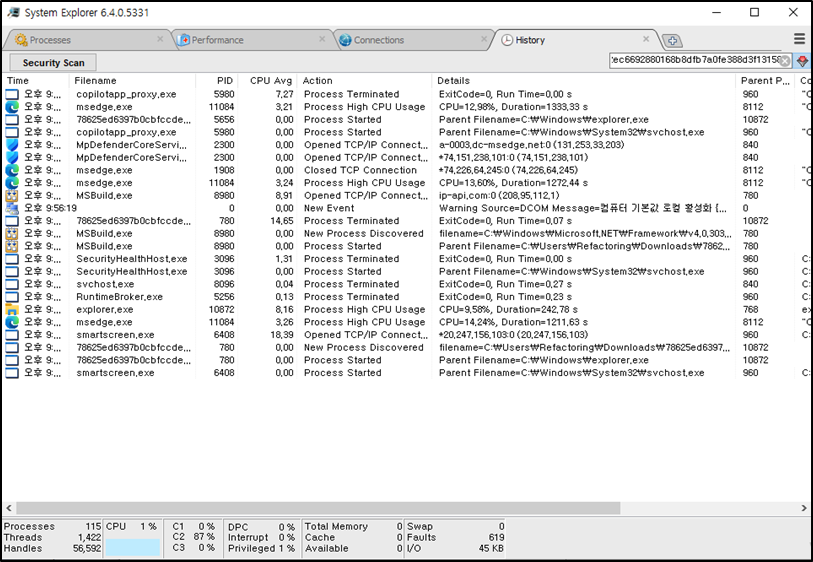

- Network Packet Analysis: Captured an HTTP GET request to `ip-api.com/line/?fields=hosting` and a plaintext response (`false`) using WireShark.

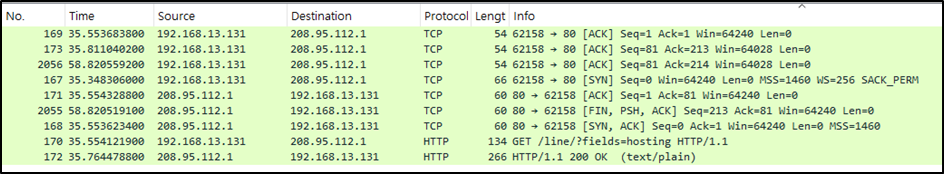
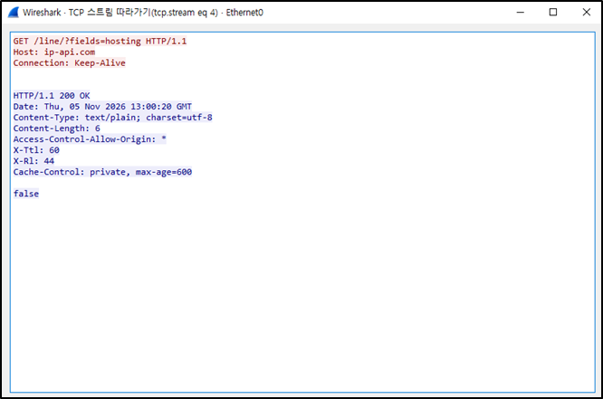

- Determined to be an anti-analysis and sandbox evasion technique that queries whether the public IP belongs to a cloud or data center subnet immediately upon execution.

--- 


### 5. Detection Pattern Design and Validation
- Deployed the open-source IDS/IPS Snort on the detection VM.
- Integrated Base to visualize detection logs through a web interface for validation.

#### 5.1. Ping Test
```
alert icmp any any -> any any (msg: "ICMP_TEST"; sid:1000001;)
```

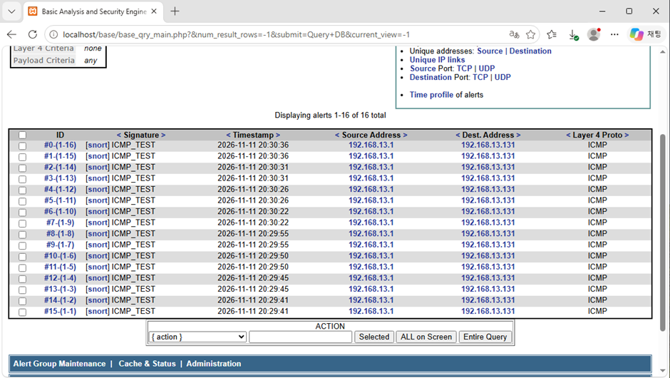

- Applied an ICMP detection rule to verify that Snort and Base were functioning properly and capturing traffic.
- Sent Ping commands from an external host to the execution VM.
- Confirmed that ICMP_TEST alerts were logged in the Base web portal.

#### 5.2. IP-Based Detection Pattern Test
```
alert tcp 192.168.13.131 any -> 208.95.112.1 80 
(
    msg:"MALWARE Outbound Connection to ip-api.com"; 
    sid:1000030; 
    rev:1;
)
alert tcp 208.95.112.1 80 -> 192.168.13.131 any 
(
    msg:"INFO Inbound Response from ip-api.com"; 
    sid:1000031; 
    rev:1;
)
```

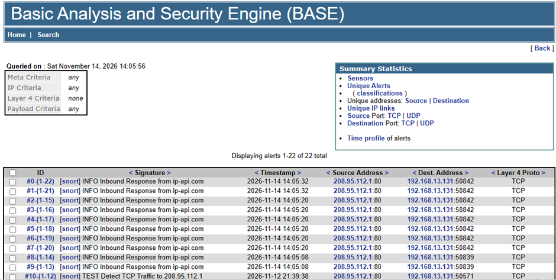

- Validation Result: Inbound response packets originating from 208.95.112.1 were successfully detected.
- However, outbound packets initiated from the internal host failed to trigger alerts, revealing a detection gap.

#### 5.3. Payload-Based Detection Pattern Test
```
alert tcp $HOME_NET any ->$EXTERNAL_NET any (
    msg:"Suspicious ip-api.com Environment Check Request";
    flow:to_server,established;
    content:"/line/?fields=hosting";
    sid:1000040;
    rev:2;
)
```

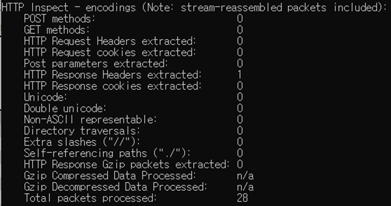

- Tested an improved rule inspecting the /line/?fields=hosting string within the payload
- However, no packets were detected (zero alerts triggered).
- Outbound payloads were likely not parsed due to HTTP preprocessor limitations in the capture environment.

--- 


### 6. Conclusion
- The analyzed malware sample employs an anti-analysis technique immediately upon execution by querying the external IP lookup service ip-api.com to detect sandbox or hosting environments.

- Proactive firewall policies should be enforced to block unauthorized IP lookup domains, alongside enhanced endpoint monitoring for sandbox detection behaviors.

- Future Work: Because IP-based signatures are vulnerable to evasion and packet drops, detection capabilities must be upgraded by correlating DNS query logs and refining deep payload inspection rules.